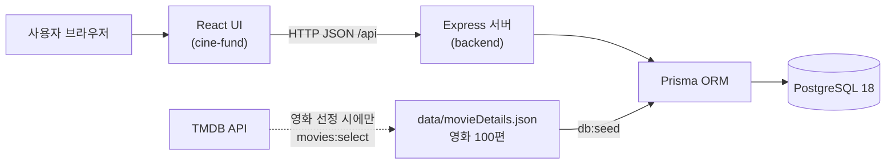
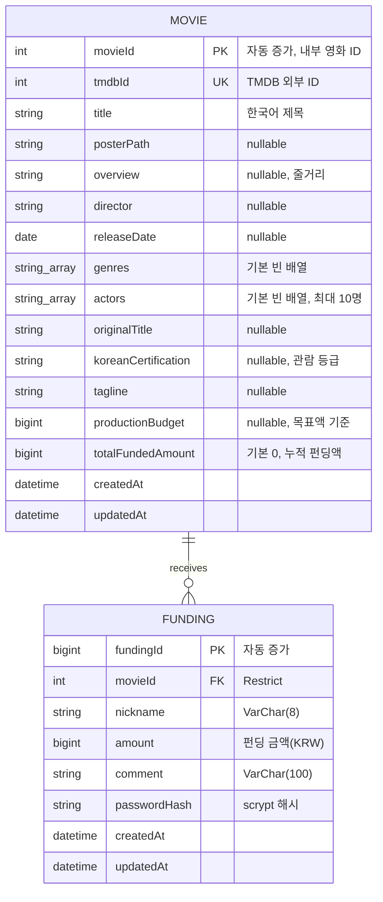

<div align="center">
  <span id="top"></span>
  <h1>🎬 CineFund (씨네펀드)</h1>

  <p><b>영화 탐색하고, 비교하고, 모의 펀딩을 남기는 웹 서비스</b></p>

  <p>코드잇 스프린트 16기 · 3팀</p>

  <!-- TODO: 서비스 대표 이미지 / 배너 -->
  <!--  -->

  <p>
    <b><a href="https://cine-fund-main.vercel.app/">CineFund 바로가기</a></b> ·
    <a href="https://www.figma.com/design/bYyl4ZsROpGqfC7nvNWyTj/시네펀딩-|-영화-탐색·펀딩-UX?node-id=2-6&t=o8qJAmEkbxW6vFaj-1">Figma</a> ·
    <a href="https://github.com/Sprint-project-1/backend">Backend 저장소</a>
  </p>
</div>

<br>

<details>
<summary>목차</summary>

1. [서비스 소개](#intro)
2. [팀 소개](#team)
3. [기술 및 개발 환경](#stack)
4. [시스템 구조](#architecture)
5. [ERD](#erd)
6. [개발 일정](#schedule)
7. [구현 기능](#feature)
8. [API 명세](#api)
9. [컨벤션](#convention)
10. [프로젝트 구조](#tree)
11. [실행 방법](#run)
12. [협업 문화](#culture)
13. [알려진 이슈 및 확정 필요 사항](#issues)
14. [문서](#docs)

</details>

<br>

## <span id="intro">📽️ 1. 서비스 소개</span>

**CineFund**는 지정된 영화 100편을 둘러보고, 여러 작품을 나란히 비교한 뒤, **로그인이나 결제 없이** 가상의 금액으로 펀딩 기록을 남겨 볼 수 있는 서비스입니다. 영화 선택을 돕고 펀딩 현황을 재미있게 확인하는 것이 목표입니다.

- **영화 탐색:** 영화 100편을 페이지당 10편씩 탐색하고, 제목으로 검색합니다. 펀딩액 기준 Top 3를 홈에서 바로 확인합니다.
- **영화 상세:** 포스터, 줄거리, 감독·출연진, 펀딩 현황과 최신 코멘트를 확인합니다.
- **영화 비교:** 2~5편을 골라 항목별로 비교합니다.
- **익명 모의 펀딩:** 닉네임·금액·코멘트·비밀번호만으로 펀딩을 남기고, 같은 비밀번호로 코멘트를 수정하거나 펀딩을 취소합니다.
- **펀딩 랭킹:** 누적 펀딩액과 달성률 기준으로 순위를 확인합니다. (무한 스크롤)

> **범위 제외:** 회원가입/로그인, 실제 결제·환불, 쿠키·localStorage 기반 사용자 상태

### 시연 영상

👉 TBD (추가 예정)

<br>

## <span id="team">🧑🏻‍💻 2. 팀 소개</span>

| 이름 | GitHub |
| --- | --- |
| 송정현 | Hallland |
| 정하준 | hajwin110118 |
| 자카 | iroNomad |
| 임현주 | hyunju-dev |
| 유신 | dachshund1216 |

<br>

## <span id="stack">🛠️ 3. 기술 및 개발 환경</span>

### Frontend


- JavaScript(JSX), React Compiler(`babel-plugin-react-compiler`), `lucide-react` 아이콘

### Backend


- Node.js `^22.12.0 || >=24.0.0`, ESM, `node --test` 기반 단위 테스트

### Database


- 팀원별 Docker 로컬 PostgreSQL, 공통 Prisma schema·migration·seed로 구조를 맞춥니다.

### 외부 데이터


- 영화 선정 단계에서만 TMDB를 호출하고, 화면 요청에서는 호출하지 않습니다.

### 디자인 · 협업


### 배포

TBD (배포 환경 확정 후 추가)

<div align="right"><a href="#top">TOP 👆🏻</a></div>

<br>

## <span id="architecture">🏗️ 4. 시스템 구조</span>

FE와 BE는 **별도 저장소**로 관리하고, 브라우저는 백엔드 API만 호출합니다. DB에는 백엔드만 Prisma로 접근합니다.



- **TMDB는 준비 단계 전용**입니다. `pnpm movies:select`가 고정 영화 100편을 선정해 JSON으로 저장하고, `pnpm db:seed`는 그 JSON만 읽어 `Movie`를 upsert합니다.
- 로컬 개발에서는 Vite 개발 서버가 `/api` 요청을 `http://localhost:3000`(Express)으로 프록시합니다. 다른 API 주소를 쓸 때만 `VITE_API_BASE_URL`을 지정합니다.
- 금액(`BigInt`)은 JSON 정밀도 손실을 피하기 위해 **문자열**로 주고받습니다.

<br>

## <span id="erd">🗂️ 5. ERD</span>

`prisma/schema.prisma` 기준입니다. (`@map`으로 DB 컬럼은 snake_case, 테이블은 `movies` / `fundings`)



**설계 포인트**

- `Funding`은 **펀딩 원장**이고, `Movie.totalFundedAmount`는 조회 성능을 위한 **누적 합계**입니다. 펀딩 생성·취소 시 두 값을 **한 DB 트랜잭션**에서 함께 갱신해 합계가 어긋나지 않게 했습니다.
- `Funding.movieId → Movie.movieId`는 `onDelete: Restrict`로, 펀딩 기록이 있는 영화는 삭제할 수 없습니다.
- 인덱스 `@@index([movieId, createdAt, fundingId])`로 영화별 최신 코멘트 조회를 지원합니다.
- 비밀번호 평문은 저장하지 않고 `scrypt:{salt}:{key}` 형태의 **솔트 포함 단방향 해시**만 저장합니다. 검증은 `timingSafeEqual`로 비교합니다.
- 로그인 기능이 없으므로 `User` 테이블은 없습니다. 펀딩 소유 확인은 펀딩 시 입력한 비밀번호로 합니다.
- **달성률**은 DB/API 필드가 아니라 `totalFundedAmount / productionBudget × 100`으로 계산합니다. `productionBudget`이 `NULL` 또는 0이면 “산정 불가”로 표시합니다.

<div align="right"><a href="#top">TOP 👆🏻</a></div>

<br>

## <span id="schedule">📅 6. 개발 일정</span>

날짜는 팀 확정 후 기입합니다. 체크 표시는 저장소에서 확인되는 산출물 기준입니다.

- [x] **M0 기획 및 설계** — 요구사항, API/DB/화면 명세, Figma 시안
- [x] **M1 개발 환경 구축** — Docker PostgreSQL, Prisma migration/seed, 영화 100편 JSON, GitHub 규칙
- [x] **M2 DB 및 API** — 조회·비교·랭킹 API, 모의 펀딩 생성/취소/코멘트 수정 API
- [x] **M3 FE 구현** — 탐색·상세·비교·결과·랭킹 화면, API 호출 코드, 로딩/빈/오류 상태
- [ ] **M4 FE/BE 연동** — 실제 서버 실행 기준 주요 흐름 검증
- [ ] **M5 테스트 및 M6 오류 수정** — P0 시나리오 통과, 결함 수정
- [ ] **M7 배포** — 배포 URL, 환경변수 가이드
- [ ] **M8 최종 점검 및 발표**

<br>

## <span id="feature">✨ 7. 구현 기능</span>

| 화면 | 경로 | 주요 기능 |
| --- | --- | --- |
| 영화 탐색 | `/` | 영화 목록(10편/페이지), 제목 검색, 펀딩 Top 3 |
| 영화 상세 | `/detail/:movieId` | 영화 정보, 펀딩 현황, 코멘트 목록(최신순 10개), 모의 펀딩 입력, 코멘트 수정·펀딩 취소 |
| 영화 비교 선택 | `/compare` | 후보 검색, 2~5편 선택 |
| 비교 결과 | `/compare-result` | 선택 영화 비교표(모바일은 카드) |
| 펀딩 랭킹 | `/ranking` | 펀딩액·달성률 정렬(오름/내림), 무한 스크롤 |

### 핵심 구현 포인트

- **페이지 번호와 cursor 페이지네이션 결합:** 서버는 cursor 방식으로 응답하고, 프런트는 방문한 페이지 번호별 cursor를 메모리에 보관해 번호형 페이지 이동을 제공합니다. 검색어가 바뀌면 첫 페이지로 돌아갑니다.
- **중복·누락 없는 랜덤 목록:** 기본 목록은 랜덤 순서지만, 첫 요청에서 만든 `seed`를 cursor에 담아 다음 페이지에서도 같은 순서를 유지합니다. 같은 값이면 `movieId`로 정렬해 순서를 고정합니다.
- **금액을 `BigInt`로 처리:** 서버는 금액을 문자열로 응답하고, 클라이언트는 부동소수점 대신 `BigInt`로 계산합니다.
- **익명 모의 펀딩 입력 검증(서버):**
  - 금액: 양의 정수 문자열(`BIGINT` 범위 이내)
  - 닉네임: 공백 제거 후 1~8자
  - 코멘트: 최대 100자
  - 비밀번호: 8~12자, 영문자와 숫자를 각각 1자 이상 포함
- **트랜잭션 처리:** 펀딩 생성·취소는 원장과 영화 누적액을 하나의 트랜잭션으로 갱신합니다.
- **일관된 오류 응답:** `VALIDATION_ERROR`, `MOVIE_NOT_FOUND`, `FUNDING_NOT_FOUND`, `INVALID_CREDENTIAL` 등 코드가 있는 JSON 오류로 응답하고, 내부 정보는 노출하지 않습니다. DB 연결 실패는 503으로 처리합니다.
- **화면 상태 처리:** 목록·상세·랭킹에서 로딩, 빈 결과, 오류와 재시도를 제공하고, 백엔드 연결 실패와 미구현 경로를 구분해 안내합니다.
- **AI 요약(비교 결과):** 현재는 시안 기반 안내 UI만 있고 서버 endpoint는 없습니다.

<div align="right"><a href="#top">TOP 👆🏻</a></div>

<br>

## <span id="api">📡 8. API 명세</span>

백엔드 `src/app.js`와 라우트 기준입니다. 상세 요청/응답은 [API_SPEC](docs/API_SPEC.md)을 참고하세요.

| 이름 | 메서드 | 엔드포인트 | 설명 |
| --- | --- | --- | --- |
| 서버 상태 | GET | `/health` | 서버 실행 확인 (DB 연결까지 확인하지는 않음) |
| 영화 목록 | GET | `/api/movies` | `limit`, `cursor`, `q`(제목 검색), `sortBy`(`amount` \| `achievementRate`), `order` |
| 영화 상세 | GET | `/api/movies/:movieId` | 영화 상세 정보와 펀딩 현황 |
| 코멘트 목록 | GET | `/api/movies/:movieId/comments` | 최신순 cursor 조회 |
| 랭킹 | GET | `/api/rankings` | `limit`(기본 10, 최대 50), `sortBy`, `order`, `cursor` |
| 영화 비교 | POST | `/api/comparisons` | 본문 `movieIds` (2~5개, 중복 불가) |
| 모의 펀딩 생성 | POST | `/api/movies/:movieId/fundings` | `amount`, `nickname`, `comment`, `password` |
| 코멘트 수정 | PATCH | `/api/fundings/:fundingId/comment` | `password`, `comment` |
| 펀딩 취소 | POST | `/api/fundings/:fundingId/cancel` | `password` |

**응답 예시 — 영화 목록** (일부 필드 생략: `tmdbId`, `originalTitle`, `koreanCertification`, `overview`, `director`, `actors`, `tagline` 등도 포함됩니다)

```json
{
  "items": [
    {
      "movieId": 1,
      "title": "영화 제목",
      "releaseDate": "2024-01-01",
      "genres": ["드라마", "미스터리"],
      "posterPath": "/example.jpg",
      "productionBudget": "0",
      "totalFundedAmount": "0"
    }
  ],
  "page": { "nextCursor": "opaque-token", "hasMore": true }
}
```

> 금액 필드는 정확도 유지를 위해 문자열입니다. `posterPath`는 전체 URL이 아니며, 화면에서 TMDB 이미지 경로(`https://image.tmdb.org/t/p/...`)와 조합합니다.

<br>

## <span id="convention">🖌️ 9. 컨벤션</span>

### Git

- 브랜치: `main` (직접 push 금지), 기능 `feature/task-12`, 버그 `fix/task-12`, 문서·정비 `docs/...`, `chore/...`
- 커밋: `<type>(<scope>): <subject>` — 예) `feat(movie-list): add cursor pagination`
- PR: Issue 연결, 변경 요약·검증 결과·캡처 기록, 최소 1명 Approve 후 병합

| 타입 | 용도 |
| --- | --- |
| `feat` | 기능 추가 |
| `fix` | 버그 수정 |
| `docs` | 문서 |
| `style` | 포맷/CSS 스타일 |
| `refactor` | 동작 유지 코드 개선 |
| `test` | 테스트 |
| `build` / `ci` | 빌드·의존성 / 자동화 설정 |
| `perf` | 성능 |
| `chore` | 기타 정비 |

### Code

| 대상 | 규칙 | 예 |
| --- | --- | --- |
| 변수/함수 | camelCase, 함수는 동사형 | `movieList`, `fetchMovie` |
| React 컴포넌트·파일 | PascalCase | `MovieCard.jsx` |
| 상수 | UPPER_SNAKE_CASE | `MAX_COMPARE_COUNT` |
| 이벤트 핸들러 | `handle` + 동작 | `handleSubmit` |

`const` 우선, `var` 금지, `===` 사용. ESLint(flat config)로 검사합니다. (`pnpm lint`) 자세한 내용은 [CODING_CONVENTION](docs/conventions/CODING_CONVENTION.md), [GIT_CONVENTION](docs/conventions/GIT_CONVENTION.md)을 참고하세요.

<br>

## <span id="tree">🌱 10. 프로젝트 구조</span>

### 🎨 Frontend — [cine-fund](https://github.com/Sprint-project-1/cine-fund)

```text
cine-fund/
├── client/
│   ├── api/
│   │   └── movies.js              # 백엔드 API 호출 함수, 오류 처리, 카드 데이터 변환
│   ├── components/
│   │   ├── Navbar.jsx             # 내비게이션, 제목 검색 제안
│   │   ├── PageHeading.jsx
│   │   ├── SkeletonBlock.jsx      # 로딩 스켈레톤
│   │   ├── FundingComment.jsx
│   │   └── AiSummaryModal.jsx     # 비교 결과 AI 요약 안내 UI
│   ├── pages/
│   │   ├── LayoutPage.jsx         # 공통 레이아웃
│   │   ├── HomePage.jsx           # 영화 탐색, Top 3
│   │   ├── DetailPage.jsx         # 영화 상세, 펀딩, 코멘트
│   │   ├── ComparePage.jsx        # 비교 영화 선택
│   │   ├── CompareResultPage.jsx  # 비교 결과
│   │   └── RankingPage.jsx        # 펀딩 랭킹
│   ├── App.jsx                    # 라우팅
│   ├── main.jsx
│   └── index.css
├── docs/                          # 기획·설계·API·DB·컨벤션 문서
├── vite.config.js                 # React, Tailwind, React Compiler, /api 프록시
├── eslint.config.js
└── .env.example                   # VITE_API_BASE_URL
```

### 🛠️ Backend — [backend](https://github.com/Sprint-project-1/backend)

```text
backend/
├── data/
│   └── movieDetails.json          # 선정된 영화 100편
├── prisma/
│   ├── schema.prisma              # Movie / Funding 모델
│   ├── migrations/                # DB 변경 이력
│   └── seed.js                    # JSON → PostgreSQL
├── src/
│   ├── app.js                     # 미들웨어, 라우터 연결, BigInt 직렬화
│   ├── server.js
│   ├── config/db.js               # Prisma 연결
│   ├── errors/createError.js
│   ├── middlewares/               # cors, errorHandler, notFound
│   ├── movies/                    # TMDB 호출, 영화 선정, 영화 데이터 검증
│   ├── routes/                    # movie, ranking, comparison, funding
│   ├── services/                  # movie, comment, ranking, funding (트랜잭션)
│   └── utils/                     # 검증, 정렬, cursor, 응답 변환, 비밀번호 해시
├── tests/                         # node --test 단위 테스트
├── scripts/checkMigrations.js
├── compose.yaml                   # PostgreSQL 18 (포트 5435)
└── .env.example
```

<div align="right"><a href="#top">TOP 👆🏻</a></div>

<br>

## <span id="culture">💪🏻 11. 협업 문화</span>

- Issue로 작업 범위와 완료 조건을 정하고, PR에서 연결해 리뷰합니다.
- 결정 사항은 채팅에만 남기지 않고 Issue/PR/문서에 날짜, 결론, 이유를 기록합니다.
- 코드와 요구사항을 논의하며, 일정 지연과 막힌 점은 발견 즉시 공유합니다.
- 정기 회의·코어타임: TBD ([GROUND_RULES](docs/conventions/GROUND_RULES.md))

<br>

## <span id="issues">🐛 12. 알려진 이슈 및 확정 필요 사항</span>

1. **목표액(`productionBudget`) 환산 규칙 미확정:** 달성률의 기준인 목표액은 KRW 정수로 쓰는 것이 계약이지만, 현재 seed는 TMDB 원본 제작비(USD)를 그대로 저장합니다. 환율·반올림 규칙이 확정되면 seed/import와 데이터 검증을 함께 변경해야 합니다.
2. **랭킹 cursor:** 이미 조회한 영화 ID를 누적해 제외하는 방식이라 중복은 없지만, 여러 페이지를 이어 붙인 전체 순서가 항상 정렬 순서와 같다고 보장하지는 않습니다.
3. **FE/BE 통합 검증:** 백엔드 API는 구현되어 있으나 펀딩 API의 DB/HTTP 통합 검증과 프런트엔드 연동 확인은 별도로 진행합니다.
4. **AI 요약:** 비교 결과의 AI 요약은 서버 endpoint와 외부 서비스 연동 범위가 정해지지 않아 안내 UI만 제공합니다.
5. **배포·일정·팀 정보:** 배포 환경, 일정, 담당 영역은 확정 후 이 문서를 갱신합니다.

<br>

## <span id="docs">📚 13. 문서</span>

- 기획: [PROJECT_SPEC](docs/PROJECT_SPEC.md) · [PRD](docs/PRD.md) · [PAGE_SPEC](docs/PAGE_SPEC.md)
- 설계: [TECH_STACK](docs/TECH_STACK.md) · [ARCHITECTURE](docs/ARCHITECTURE.md) · [API_SPEC](docs/API_SPEC.md) · [DATABASE_SCHEMA](docs/DATABASE_SCHEMA.md)
- 실행 계획: [TASK_BREAKDOWN](docs/TASK_BREAKDOWN.md) · [ROLE_ASSIGNMENT](docs/ROLE_ASSIGNMENT.md) · [MILESTONES](docs/MILESTONES.md)
- 품질: [SECURITY_POLICY](docs/SECURITY_POLICY.md) · [TEST_PLAN](docs/TEST_PLAN.md)
- 협업: [CODING_CONVENTION](docs/conventions/CODING_CONVENTION.md) · [GIT_CONVENTION](docs/conventions/GIT_CONVENTION.md) · [GROUND_RULES](docs/conventions/GROUND_RULES.md)

<div align="right"><a href="#top">TOP 👆🏻</a></div>
