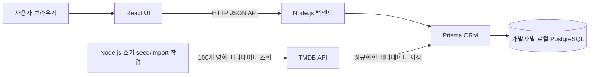

# 시스템 아키텍처

> 애플리케이션 구조 초안. Figma에는 회원가입/로그인 화면은 없지만 상세 화면에 비로그인 펀딩 입력 및 코멘트 수정 UI가 있다. 화면 설계와 등록 API/DB 동작 결정은 별개다. 개발 시에는 팀원별 Docker 환경에 독립적인 PostgreSQL을 두고, 공통 schema/migration/seed로 구조를 맞춘다. 운영 DB 구성과 Express는 미확정이다.

> 현재 저장소 `main`에는 Vite/React 프런트엔드 scaffold만 확인된다. 아래 백엔드·DB 흐름은 계획 아키텍처이며 구현 현황이 아니다. FE는 `client/`에 있고, 내부 서버/API와 Prisma/DB 설정은 아직 저장소 트리에서 확인되지 않는다.

## 구성도

각 개발자는 위 애플리케이션 구성을 자신의 Docker 개발 환경에서 실행한다. 로컬 PostgreSQL 데이터는 개발자별로 독립적이며 팀원 간 DB 서버를 공유하지 않는다. 팀이 공유하는 것은 Prisma schema, 마이그레이션, seed 절차다. 통합/운영 환경의 공용 DB는 별도 결정 사항이다.

## 경계와 데이터 흐름

- React는 화면과 사용자 입력을 담당하며 API를 통해 서버와 통신한다. 브라우저에서 PostgreSQL에 직접 접속하지 않는다.
- Node 서버는 화면의 조회 API, 입력 검증, 도메인 규칙, 오류 변환을 담당한다. 초기 데이터 적재용 seed/import 작업은 별도 실행 흐름으로 TMDB를 호출한다.
- Prisma는 백엔드에서 PostgreSQL 조회/수정 및 트랜잭션을 수행하는 ORM이다. list/funding은 논리적 데이터 영역이며 두 DB를 뜻하지 않는다.
- PostgreSQL은 핵심 영화 데이터와 모의 펀딩 기록 관계를 보관하는 구조를 목표로 한다. 구체 테이블/집계 방식은 별도 DB/API 합의 사항이다.
- TMDB API 키는 Node.js seed/import 실행 환경의 비밀 변수로 보관한다. PostgreSQL 자체가 TMDB를 호출하는 것이 아니라 import 스크립트가 TMDB 응답을 받아 Prisma로 저장한다. 지정 100편 메타데이터는 DB에서 제공하며 앱 화면 요청 때 TMDB를 실시간 호출하지 않는다. 갱신 시점/책임은 TBD다.
- 로컬 개발에서는 각자의 PostgreSQL 컨테이너를 사용한다. FE/BE 컨테이너와 DB 컨테이너를 함께 실행할지, FE/BE를 호스트에서 실행하고 DB만 컨테이너화할지는 저장소 설정 단계에서 확정한다.
- Prisma schema와 커밋된 migration이 DB 구조의 기준이다. 새 팀원은 같은 migration을 적용하고 필요한 초기 영화 데이터는 seed 절차로 입력한다. 개인 DB 데이터를 서로 주고받아 구조를 맞추지 않는다.

## 주요 흐름

### 영화 조회

1. React가 `GET /api/movies?limit=...&cursor=...` 호출
2. 서버가 입력 검증 후 Prisma로 영화 정보를 조회하고, 모의 펀딩 누적액/달성률을 함께 조회 (필드·계산 계약 TBD)
3. 영화 메타데이터는 사전 seed/import로 DB에 적재된 값을 사용한다. TMDB에 없는 값은 NULL/기본 표시 정책을 따른다.
4. API 표준 JSON 반환, React는 로딩/빈/오류/목록 상태를 표시

기본 랜덤 순서가 페이지 요청마다 변하면 누락/중복이 생길 수 있다. 제안은 첫 목록의 순서를 고정하고 cursor와 함께 유지하는 것이며, 쿠키/localStorage를 쓰지 않는 제약 아래 stateless seed 또는 서버 저장 방식 중 팀 결정이 필요하다.

### 익명 펀딩 참여 UI와 등록 흐름 (서버 계약은 제안)

> 비로그인·무결제 모의 펀딩은 서비스 목표다. 아래는 그 기능을 처리하는 서버 흐름의 검토안이다. UI와 기능 목표는 유지하고, 구체적인 입력 검증·endpoint·저장/수정 권한은 API 담당자와 합의하기 전 제안으로 둔다.

1. React가 금액, 닉네임, 코멘트, 비밀번호를 POST
2. 서버가 영화 존재 여부와 모든 입력을 검증
3. 비밀번호 해시 생성 후 트랜잭션에서 Funding 원장 기록
4. 응답은 비밀 값 제외. 누적 금액을 재집계하거나 동시성 안전하게 갱신

### 코멘트 수정 (세부 정책/API 합의가 필요한 제안 흐름)

1. 클라이언트가 `fundingId`, 비밀번호, 새 코멘트로 PATCH
2. 서버가 기록을 조회하고 해시와 비밀번호 비교
3. 일치할 때에만 코멘트를 갱신. 틀리면 일반화된 401/403 오류 응답
4. 시도 횟수 제한과 비밀번호 해시 알고리즘/비용은 구현 전 결정

## 오류 및 환경변수

TMDB seed/import 작업의 timeout/실패, DB 오류, 입력 오류를 구분해 처리한다. import 실패 시 일부 데이터만 성공한 상태를 정리하는 방식은 트랜잭션/재실행 안전성 설계로 보완한다. 앱 API 오류는 내부 stack trace와 비밀을 응답하지 않고 서버 로그에도 비밀번호를 남기지 않는다. 환경변수 예시: `DATABASE_URL`, `TMDB_API_KEY`(seed/import 실행용), `PORT`, `CLIENT_ORIGIN`(이름은 제안). `.env`는 커밋하지 않고 `.env.example`에는 빈 placeholder만 둔다. 배포 환경의 secret manager/환경변수 설정은 플랫폼 결정 후 문서화한다.

로컬 Docker 설정에서는 DB 연결 주소가 실행 위치에 따라 달라진다. 백엔드도 컨테이너 안에서 실행하면 Compose 서비스 이름을 호스트로 사용하고, 백엔드가 호스트에서 실행되면 공개한 로컬 포트를 사용한다. 실제 변수값은 환경별로 설정하며 팀에 비밀키나 개인 `.env` 파일을 공유하지 않는다. TMDB 요청은 준비 단계의 서버 측 seed/import에서만 수행하고 `TMDB_API_KEY`를 프런트엔드 컨테이너/번들에 넣지 않는다.
