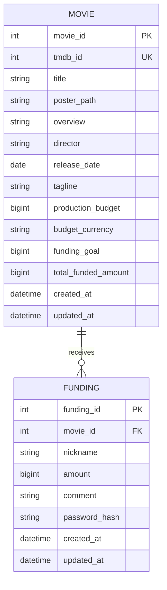

# 데이터베이스 스키마 초안

> 검토용 설계이며 구현 확정안이 아니다. `list DB`, `funding DB`는 논리 영역으로 해석한다. TMDB는 초기 seed/import에서 지정한 영화 100편을 조회해 PostgreSQL에 적재하고, 앱 요청 때마다 호출하지 않는 방향이다. 개발자는 각자 로컬 PostgreSQL을 실행하지만 모두 같은 Prisma schema·migration·seed 절차를 사용한다.

## 관계



## 테이블 제안

| 테이블.컬럼 | 타입 제안 | 제약/설명 |
|---|---|---|
| Movie.movie_id | SERIAL/INTEGER | PK 내부 ID |
| Movie.tmdb_id | INTEGER | UNIQUE NOT NULL, 외부 식별자 |
| Movie.title | VARCHAR | NOT NULL |
| Movie.poster_path | TEXT | NULL 가능. Figma 카드/비교표 표시 후보; TMDB 매핑 및 저장 필요성은 TBD |
| Movie.overview | TEXT | NULL 가능. 비교 결과 설명 후보; TMDB 매핑 및 저장 정책은 TBD |
| Movie.director | TEXT | NULL 가능. Figma 비교 항목 후보; 데이터 출처/수집 경로와 복수 감독 표현은 TBD |
| Movie.release_date | DATE | NULL 허용 |
| Movie.genres | JSONB 또는 별도 MovieGenre | TBD; 장르 정규화 여부 결정 |
| Movie.tagline | TEXT | NULL 허용 |
| Movie.production_budget | BIGINT | NULL 가능, TMDB 값 원 단위/통화 확인 전 환산 금지 |
| Movie.budget_currency | CHAR(3) | 외부 값의 통화 보존 방안 TBD |
| Movie.funding_goal | BIGINT | NULL 가능; 팀이 정한 서비스 통화의 목표액 |
| Movie.total_funded_amount | BIGINT | NOT NULL DEFAULT 0; 초기 적재 시 0. 테스트용 펀딩 기록을 추가하면 합계와 일치하도록 갱신 |
| Movie.created_at / updated_at | TIMESTAMPTZ | NOT NULL, 기본 현재 시각 |
| Funding.funding_id | BIGSERIAL | PK |
| Funding.movie_id | INTEGER | FK → Movie.movie_id, NOT NULL, 삭제 정책 restrict 제안 |
| Funding.nickname | VARCHAR(8) | NOT NULL, trim 후 비어 있지 않음 |
| Funding.amount | BIGINT | NOT NULL, CHECK(amount > 0), 최소/최대 TBD |
| Funding.comment | VARCHAR(100) | NOT NULL 또는 빈 코멘트 허용 여부 TBD |
| Funding.password_hash | TEXT | NOT NULL, 검증 가능한 강한 단방향 해시만 저장 |
| Funding.created_at / updated_at | TIMESTAMPTZ | NOT NULL; 최신순 기준은 created_at, funding_id tie-break |

외부 TMDB 식별자에는 `tmdb_id` 컬럼명을 API/DB에서 사용한다. 목표액과 원본 제작비는 별도 값이다. 통화 변환 정책 확정 전 `funding_goal`을 자동 설정하지 않는다. 초기 seed/import는 고정된 `tmdb_id` 목록을 입력으로 사용하고, 재실행 시 이미 존재하는 영화는 중복 생성하지 않도록 upsert하는 방안을 제안한다.

## Prisma 모델 초안

```prisma
model Movie {
  movieId            Int       @id @default(autoincrement()) @map("movie_id")
  tmdbId             Int       @unique @map("tmdb_id")
  title              String
  posterPath         String?   @map("poster_path")
  overview           String?
  director           String?
  releaseDate        DateTime? @map("release_date") @db.Date
  genres             Json?
  tagline            String?
  productionBudget   BigInt?   @map("production_budget")
  budgetCurrency     String?   @map("budget_currency") @db.Char(3)
  fundingGoal        BigInt?   @map("funding_goal")
  totalFundedAmount  BigInt    @default(0) @map("total_funded_amount")
  createdAt          DateTime  @default(now()) @map("created_at")
  updatedAt          DateTime  @updatedAt @map("updated_at")
  fundings           Funding[]
  @@map("movies")
}

model Funding {
  fundingId    BigInt   @id @default(autoincrement()) @map("funding_id")
  movieId      Int      @map("movie_id")
  nickname     String   @db.VarChar(8)
  amount       BigInt
  comment      String   @db.VarChar(100)
  passwordHash String   @map("password_hash")
  createdAt    DateTime @default(now()) @map("created_at")
  updatedAt    DateTime @updatedAt @map("updated_at")
  movie        Movie    @relation(fields: [movieId], references: [movieId], onDelete: Restrict)
  @@index([movieId, createdAt, fundingId])
  @@map("fundings")
}
```

Prisma만으로 모든 CHECK 제약을 표현하기 어려운 버전/기능 차이가 있을 수 있으므로 마이그레이션 SQL에서 확인한다. 문자 길이, amount 상한 검증은 서버와 DB 모두에서 가능한 수준으로 적용한다.

## 집계, 동시성, 정책

> Movie의 포스터/설명/감독 컬럼과 `total_funded_amount` 캐시 컬럼은 검토 초안이다. 초기 데이터는 총액 0으로 시작하고 테스트용 펀딩 기록을 넣어 정렬/달성률을 확인하는 방향이다. 실제 구현 시 원장 합계와 캐시 일관성 유지 방식을 팀이 검토한다.

- 원장은 `Funding.amount` 기록이며 `total_funded_amount`는 표시/정렬을 위한 집계값 제안이다. 값은 Funding 합계와 항상 일치해야 한다.
- 초기 영화 적재 시 `total_funded_amount=0`으로 둔다. 초기 Funding 원장 데이터가 없으면 누적액 0을 의미한다. 정렬/달성률 검증에 필요한 테스트 금액은 개발 전용 Funding fixture/seed로 넣고 실사용 데이터와 분리한다.
- Funding insert와 집계값 증가를 한 DB 트랜잭션에서 수행하고 동시 요청에서 원자적 증가/잠금을 사용한다. 읽기-계산-쓰기는 lost update를 일으킬 수 있다. 정기 재집계로 원장 합계와 검증하는 방안도 검토한다.
- 달성률 제안식: `totalFundedAmount / fundingGoal × 100`; 목표액 NULL/0이면 `null`로 응답한다. 표시 반올림과 목표 초과 표기는 TBD.
- Movie 삭제는 FK 보호를 위해 기본 restrict 제안. Funding 삭제/수정(금액 변경)은 감사·집계 정책 결정 전 허용하지 않는 안을 제안한다. 코멘트 수정은 Funding.comment만 변경한다.
- 비밀번호 해시는 응답/로그 금지. salt/알고리즘 비용은 사용 라이브러리 검토 후 결정한다.

## 팀 개발 환경에서의 DB 동기화 제안

- 저장소의 Prisma schema와 migration 파일을 DB 구조의 단일 기준으로 관리한다. 로컬에서 schema를 임의로 수정해 migration 없이 사용하는 방식은 피한다.
- 각 팀원은 Docker로 자기 컴퓨터에 PostgreSQL을 실행하고 같은 migration을 적용한다. DB 데이터/볼륨은 개인 로컬 개발 데이터이므로 팀 공용 데이터로 취급하거나 Git에 올리지 않는다.
- 공통 영화 100편은 고정된 TMDB ID 목록을 기준으로 seed/import 절차에서 조회·저장한다. 인기순을 실행할 때마다 다시 뽑지 않아 모든 팀원이 같은 영화를 보게 한다. TMDB 제목/개봉일/장르/슬로건/제작비와 Figma에 필요한 포스터/설명/감독 필드를 매핑한다. 요청 필드, 저장 매핑, upsert/갱신 정책 및 ID 목록 관리 담당자는 별도 합의가 필요하다.
- seed/import는 TMDB API 키를 서버 측 환경변수로 사용하고 브라우저에서는 호출하지 않는다. 일부 영화 요청 실패 시 전체 실패/부분 적재 중 어떤 정책을 택할지는 구현 전에 정하며, 안전한 재실행을 지원한다.
- 공유 DB가 필요한 통합 테스트/배포 환경은 로컬 개발 DB와 분리해 별도 선택·접근 통제한다. 로컬 `.env`의 `DATABASE_URL`과 API 키는 커밋하지 않고 `.env.example`에는 변수명과 설명만 둔다.
- DB 컨테이너/Compose 파일, PostgreSQL 버전, 포트, volume 이름 및 migration/seed 실행 명령은 저장소 초기 설정 때 결정한다.
