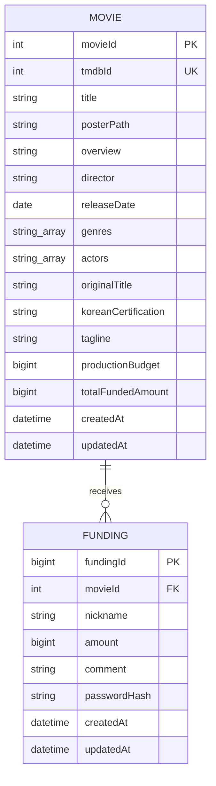

# 데이터베이스 스키마

> 현재 구현 기준 문서. 기준 파일은 `prisma/schema.prisma`와 적용된 migration이다. API는 아직 구현 전이며, 아래 API 계약은 `docs/API_SPEC.md`를 따른다.

## 현재 구현된 모델

| 모델.필드 | Prisma 타입 / 제약 | 의미 |
|---|---|---|
| `Movie.movieId` | `Int`, 자동 증가, PK | CineFund 내부 영화 ID |
| `Movie.tmdbId` | `Int`, unique | TMDB 외부 식별자 |
| `Movie.title` | `String` | 한국어 영화 제목 |
| `Movie.posterPath`, `overview`, `director` | nullable `String` | 포스터 경로, 줄거리, 감독 |
| `Movie.releaseDate` | nullable `DateTime @db.Date` | 개봉일 |
| `Movie.genres`, `actors` | `String[]`, 기본 빈 배열 | 장르 및 출연진 문자열 목록 (JSON 컬럼이 아님) |
| `Movie.originalTitle`, `koreanCertification`, `tagline` | nullable `String` | 원제, 한국 관람 등급, 태그라인 |
| `Movie.productionBudget` | nullable `BigInt` | 모의 펀딩 목표액(KRW 정수). TMDB 원본 USD 제작비를 합의된 환율로 환산한 값 |
| `Movie.totalFundedAmount` | `BigInt`, 기본값 `0` | 누적 모의 펀딩액. 화면/서비스 계약의 통화는 KRW |
| `Movie.createdAt`, `updatedAt` | `DateTime`, timestamptz(3) | 생성/수정 시각 |
| `Funding.fundingId` | `BigInt`, 자동 증가, PK | 펀딩 기록 ID |
| `Funding.movieId` | `Int`, FK → `Movie.movieId` | 대상 영화. 영화 삭제는 `Restrict` |
| `Funding.nickname` | `VarChar(8)` | 펀딩 표시 이름 |
| `Funding.amount` | `BigInt` | 모의 펀딩 금액 (KRW) |
| `Funding.comment` | `VarChar(100)`, 필수 | 펀딩 코멘트. 빈 문자열 허용 여부는 API 입력 규칙과 함께 확인 |
| `Funding.passwordHash` | `String` | 코멘트 수정/취소 검증용 해시만 저장. 평문 금지 |
| `Funding.createdAt`, `updatedAt` | `DateTime`, timestamptz(3) | 생성/수정 시각 |

Funding에는 `(movieId, createdAt, fundingId)` 인덱스가 있다. 실제 필드, 컬럼 매핑, 기본값과 제약은 현재 Prisma schema/migration을 우선한다.

## 데이터 적재와 금액 규칙

- 고정 선정 목록과 영화 상세 데이터는 `data/movieDetails.json`에 저장한다. `pnpm movies:select`는 영화 선정 단계에서 TMDB를 사용하고, `pnpm db:seed`는 JSON 파일만 읽어 `Movie`를 upsert한다. 앱의 영화 조회 요청마다 TMDB를 호출하지 않는다.
- 팀 결정: TMDB 원본 제작비(`budget`, USD)를 모의 펀딩 목표액의 기준으로 삼고, DB의 `Movie.productionBudget`에는 이를 KRW로 환산한 정수 목표액을 저장한다. 원본 USD는 seed/import JSON에서 보존한다.
- 환율 숫자와 원 단위 반올림 방식은 TBD다. 별도 `fundingGoal` DB 컬럼은 두지 않으며, `productionBudget` 자체가 KRW 목표액이다. API도 이 값을 KRW 정수 문자열로 반환한다.
- 현재 백엔드 seed/check 스크립트는 TMDB USD 값을 `productionBudget`에 그대로 저장·비교한다. 합의된 환율과 반올림 규칙을 정한 뒤 KRW 변환을 반영해야 하며, 그 전까지 이 부분은 구현 계약과 현재 코드가 불일치한다.
- 달성률은 `totalFundedAmount / productionBudget × 100`으로 계산한다. `productionBudget`이 NULL 또는 0이면 달성률을 계산하지 않는다.
- `totalFundedAmount`는 펀딩 원장 합계와 일치해야 한다. 펀딩 생성/취소와 누적액 증감은 한 트랜잭션으로 처리한다. 동시성 제어와 재집계 구현은 API 구현 시 검증한다.
- seed 재실행은 고정 TMDB ID를 기준으로 upsert한다. 기존 누적액과 펀딩 기록은 덮어쓰지 않으며, 고정 목록 밖 영화가 DB에 있으면 자동 삭제하지 않고 중단한다.

## API 직렬화와 검증

- PostgreSQL `BigInt` 값은 JSON number의 정밀도 손실을 피하도록 API에서 문자열로 반환한다. 클라이언트는 금액 산술을 부동소수점으로 처리하지 않는다.
- 펀딩 비밀번호 계약은 영문자와 숫자를 각각 하나 이상 포함하는 8~12자다. 서버는 평문을 저장하거나 응답/로그에 남기지 않고 검증 가능한 단방향 해시만 보관한다.
- `Funding.amount`의 허용 최소·최대, 닉네임/코멘트의 공백·문자 길이 세부 규칙은 `docs/API_SPEC.md`에 명시된 결정 상태를 따른다. DB 제약과 서버 검증을 함께 적용한다.

## 로컬 DB 운영

- 팀원별 Docker PostgreSQL은 독립 데이터베이스이며, 공통 기준은 Prisma schema와 migration이다. 로컬 데이터/볼륨과 `.env`는 Git에 올리지 않는다.
- migration이 데이터베이스 구조의 이력이다. schema를 직접 바꾸고 migration 없이 공유하지 않는다. 공용 통합/운영 DB는 별도 결정 사항이다.
