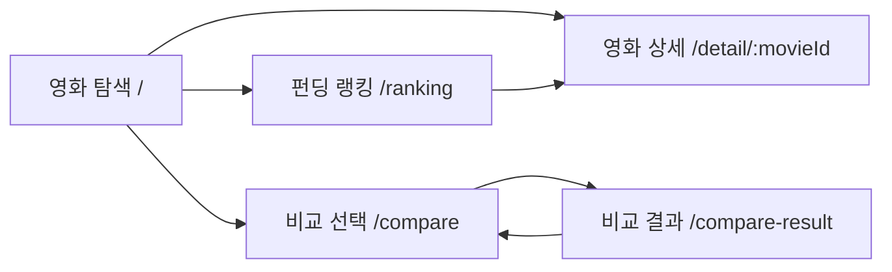

# 페이지 UI 및 동작 명세

> 기준: [CineFund Figma 시안](https://www.figma.com/design/bYyl4ZsROpGqfC7nvNWyTj/시네펀딩-|-영화-탐색·펀딩-UX?node-id=2-6&t=o8qJAmEkbxW6vFaj-1)과 현재 프런트엔드 코드. 이 문서는 FE/BE 공용 명세다. 화면과 상호작용은 Figma, 서버 요청/응답은 [API_SPEC](API_SPEC.md)을 기준으로 하며 서버 endpoint가 문서에 있다고 해서 구현 완료로 보지 않는다.

## 공통

- FE는 `client/`의 React 앱이며 CineFund 내부 API를 호출한다. DB에 직접 연결하거나 화면 요청에서 TMDB API를 호출하지 않는다.
- 공통 헤더는 영화 탐색, 비교, 랭킹 내비게이션과 제목 검색 제안을 제공한다. 검색은 `GET /api/movies?q=...`의 제목 검색이며 연도·장르 필터는 제공하지 않는다.
- 로컬 Vite 개발에서는 상대 경로 `/api`를 사용해 Vite proxy가 `http://localhost:3000`으로 전달한다. 다른 API origin을 쓸 때 `VITE_API_BASE_URL`을 설정한다. 백엔드 연결 실패와 미구현 경로는 별도 오류로 표시한다.
- 영화 금액은 API가 반환하는 정수 문자열을 `BigInt`로 다룬다. `productionBudget`과 펀딩 금액은 KRW다. 제작비가 없거나 0이면 목표액을 미표시하고 달성률을 “산정 불가”로 표시한다. 환율 변환은 FE에서 하지 않는다.
- 영화 비교 선택은 메모리 상태만 사용한다. 계정/로그인, 쿠키/localStorage 기반 사용자 상태, 실제 결제/환불은 범위에 없다.
- 펀딩 및 코멘트 생성·수정·취소는 익명 모의 기능이다. 비밀번호는 API 요청에만 전송하며 화면이나 로그에 보관하지 않는다.

## 페이지별 동작 및 API

| 현재 FE 경로 | 화면 목적 / Figma 구성 | FE 동작 및 API 계약 | 구현 상태 |
|---|---|---|---|
| `/` | 영화 탐색, 펀딩 Top 3 레일, 영화 카드와 페이지 번호 | Top 3는 `GET /api/movies?limit=3&sortBy=amount&order=desc`; 목록은 `GET /api/movies?limit=10&q=...&cursor=...`. 검색 변경 시 첫 페이지로 이동한다. cursor는 방문한 페이지 번호별로 메모리에 보관한다. 카드 선택 시 `/detail/:movieId`로 이동한다. | 목록/Top 3 API 연결. 데이터 서버 제공 필요. |
| `/detail/:movieId` | 포스터, 제목·메타정보, 줄거리, 펀딩 현황, 최신 코멘트, 모의 펀딩 입력 | 상세 `GET /api/movies/{movieId}`; 코멘트 `GET /api/movies/{movieId}/comments?limit=10&cursor=...`; 생성 `POST /api/movies/{movieId}/fundings`; 수정 `PATCH /api/fundings/{fundingId}/comment`; 취소 `POST /api/fundings/{fundingId}/cancel`. 취소 확인만 API 호출하며 취소/X 버튼은 팝업을 닫는다. | FE 연결 완료. endpoint 구현 여부는 API 명세/BE 저장소에서 별도 확인. |
| `/detail` | 식별자 없는 이전 링크 호환 | `state.movieId` 또는 `state.movie.movieId`가 있으면 상세 API로 조회한다. 식별자가 없으면 목록으로 안내한다. 신규 링크는 `/detail/:movieId`를 사용한다. | 호환 경로 |
| `/compare` | 후보 검색, 선택 영화, `n/5`, 비교 CTA | 후보 목록은 `GET /api/movies?limit=10&q=...&cursor=...`. 2~5개 ID를 메모리에서 관리하고 CTA에서 `/compare-result`로 ID 배열을 넘긴다. | 후보 검색 API 연결. |
| `/compare-result` | 선택 영화 비교표/모바일 카드, 수정·복사 액션, AI 요약 시안 | 라우터 메모리 state에서 `movieIds`를 받아 `POST /api/comparisons`로 결과를 조회한다. 새로고침/직접 진입으로 state가 없으면 선택 안내를 표시한다. AI 요약은 endpoint가 없어 시안의 안내 UI만 제공한다. | 비교 API 연결. |
| `/ranking` | 펀딩액/목표액/달성률 순위와 무한 스크롤 | `GET /api/movies?limit=10&sortBy=amount|achievementRate&order=asc|desc&cursor=...`. 정렬을 바꾸면 cursor와 목록을 초기화한다. | cursor 목록 API 연결. |

## 로딩·빈 결과·오류

- 목록과 상세는 로딩, 빈 상태, API 오류 및 재시도 동작을 제공한다. 코멘트는 빈 상태와 다음 묶음 로딩을 제공한다.
- 순위 목록은 첫 페이지 및 추가 페이지 로딩과 재시도 동작을 제공한다.
- API 응답 필드, 오류 코드는 [API_SPEC](API_SPEC.md), DB 기준 데이터는 [DATABASE_SCHEMA](DATABASE_SCHEMA.md)를 따른다.
- 비교 결과 AI 요약 API, 동의 체크 문구/서버 기록 여부, 코멘트 빈 값 정책은 확정되지 않았다.

## 사용자 흐름

