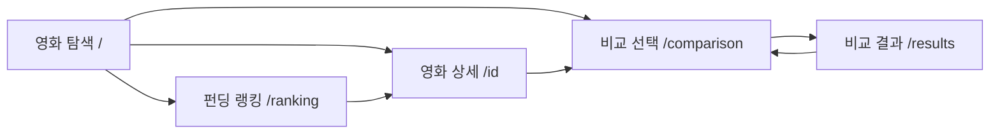

# 페이지 UI 및 동작 명세

> 기준: [CineFund Figma 시안](https://www.figma.com/file/bYyl4ZsROpGqfC7nvNWyTj?node-id=2:2&locale=ko-kr&type=design). Figma에서 확인되는 화면 요소와 실제 API/서버 동작의 결정 상태를 구분한다. 시안에 회원가입 화면은 없지만 상세 화면에는 **익명 펀딩 참여 입력 UI**가 있다. 회원가입이 없다는 이유만으로 펀딩 UI를 삭제하거나, 반대로 시안만으로 API 계약이 확정되었다고 보지 않는다.

> 라우팅 기준을 구분한다: 현재 GitHub `main`의 `client/App.jsx`에는 `/`, `/detail`, `/compare`, `/compare-result`, `/ranking`이 등록되어 있다. 기존 기획/Figma 경로(`/`, `/{id}`, `/comparison`, `/results`, `/ranking`)와 다른 경로는 아래에서 목표와 현재 구현을 함께 기록한다. 영화 탐색·비교 결과·랭킹은 예시 데이터 기반 UI가 구현되어 있고, 상세·비교 선택은 placeholder다. 어떤 페이지도 백엔드 API 연동 완료를 뜻하지 않는다.

## 공통 UI

- 데스크톱·태블릿·모바일 화면 프레임이 준비되어 있다. 실제 브레이크포인트와 세부 반응형 동작은 구현 전 Figma에서 확인한다.
- 공통 헤더에는 로고, 영화 탐색/랭킹/비교 내비게이션, 영화 검색 입력이 보인다. 검색 API와 검색 대상 범위는 TBD다.
- 디자인은 밝은 배경과 카드형 영화 정보, 포스터, 청록색 계열 주요 액션/진행 표시를 사용한다. 정확한 색상 토큰·타이포그래피·간격은 디자인 시스템 기준을 확인한다.
- 로그인·회원가입·계정 생성 화면은 시안에 없다. 서비스는 비로그인 흐름으로 설계하며 사용자 상태를 쿠키/localStorage에 저장하지 않는다.
- 펀딩은 실제 결제가 아닌 모의 기능이다. 결제 수단 정보는 수집하지 않는다.
- 영화 제목·개봉일·장르·슬로건·제작비·포스터 등은 사전 적재된 PostgreSQL 데이터에서 조회한다. 페이지를 열 때마다 TMDB에 요청하지 않는다.
- 로딩·빈 결과·오류·재시도 화면은 시안에서 모두 확정되지 않았다. 구현 시 상태 설계와 문구를 보완한다.

## 페이지별 명세

| 목표 경로 (기획/Figma) | 현재 `main` 경로 | 목적 및 시안 구성 | 사용자 동작 및 데이터 | 상태 및 이동 |
|---|---|---|---|
| `/` | `/` | 영화 탐색. 소개 영역, 펀딩순위 Top 3 가로 레일, 전체 영화 카드 목록과 공통 검색 헤더가 보인다. | 영화 카드는 `/detail`로 이동한다. 현재 FE 화면은 API 연결 전 예시 데이터 15편을 사용하며 목록은 페이지당 최대 10편으로 나눈다. 페이지 버튼으로 이동하고 검색어가 바뀌면 1페이지로 돌아간다. 헤더 검색은 현재 로컬 예시 데이터의 제목·장르·연도로 필터링한다. 실제 100편 데이터·랜덤 순서·서버 연동·오류 처리는 백엔드 데이터 계약 후 연결한다. **현재 영화 탐색 UI는 페이지 버튼 방식**이다. 무한 스크롤을 이 페이지에도 적용할지는 별도 합의가 필요하다. 정렬 요구는 유지하며 노출 위치는 TBD다. |
| `/{id}` | `/detail` (현재 동적 ID 없음) | 포스터·제목·메타 정보와 누적 펀딩/목표/달성률, 코멘트, 펀딩 참여 영역. 펀딩 취소와 코멘트 수정/비밀번호 확인 팝업 시안. | 익명 참여 입력은 닉네임·금액·코멘트·비밀번호·동의 항목으로 보인다. UI 및 API의 구체 계약은 별도 합의. 현재 `DetailPage.jsx`는 placeholder이며 라우트에 영화 ID 전달 방식이 없다. |
| `/comparison` | `/compare` | 영화 비교 선택. 검색 결과 패널, 선택 개수 `n/5`, 제거/추가와 비교 CTA. | 2~5개 선택 후 비교 결과 목표 경로로 이동. 검색 UI의 실제 기능/API는 TBD. 선택 상태는 메모리/URL 전달을 검토하며 브라우저 저장소로 보존하지 않는다. 현재 `ComparePage.jsx`는 placeholder다. |
| `/results` | `/compare-result` | 선택 영화를 비교표/카드로 비교. 시안에 설명·감독·펀딩액·달성률 후보, 재선택/공유 액션과 AI 비교 요약 팝업이 있다. | 현재 `CompareResultPage.jsx`는 라우터 state로 받은 영화를 표/모바일 카드로 표시하고, 비교 수정·결과 복사·AI 요약 팝업 UI를 제공한다. state가 없거나 영화가 2개 미만이면 비교 선택 안내를 표시한다. API 연동은 없고 AI 요약은 자리표시 문구다. |
| `/ranking` | `/ranking` | 펀딩 순위. 정렬 선택, 펀딩액/목표액/달성률 목록. | 현재 `RankingPage.jsx`는 샘플 30개를 클라이언트에서 정렬하고 처음 10개를 표시한다. 화면 하단에 접근하면 IntersectionObserver로 다음 10개를 추가하며, 400ms 로딩 표시는 시뮬레이션이다. 백엔드 API·cursor 기반 추가 조회는 아직 연결되지 않았다. 네 가지 정렬 UI는 구현되어 있다. |

## 시안에서 확인된 내용과 미확정 내용

| 구분 | 항목 |
|---|---|
| 시안에서 확인 | 다섯 페이지 흐름, 검색 입력 UI, 펀딩 참여 입력 UI, 펀딩 취소 팝업, 코멘트 수정/비밀번호 팝업, 2~5개 비교 선택, 비교 결과, 랭킹, AI 요약 팝업, 데스크톱·태블릿·모바일 프레임 |
| 유지 및 화면 합의 반영 | 영화 100편, 기본 랜덤 목록, 영화 탐색 목록 페이지당 10편 및 페이지네이션, 펀딩액/달성률 정렬, 2~5개 비교, 닉네임 최대 8글자, 코멘트 최대 100글자, 최신 코멘트 10개 단위 |
| 현재 UI 동작 (API 미연결) | 영화 탐색은 번호 페이지네이션, 랭킹은 스크롤 시 샘플 항목 추가 표시. 랭킹의 서버 페이지네이션 방식과 무한 스크롤을 최종 요구사항으로 할지는 API/팀 합의 필요 |
| 팀/API 합의 필요 | 익명 펀딩 생성 endpoint와 서버 처리, 금액/통화/목표액 공식, 펀딩 취소가 실제 취소인지 팝업 닫기인지, 동의 문구 의미, 댓글 수정 권한/횟수, 검색 범위/API, AI 요약 MVP 여부, 비교 항목, 페이지 번호와 cursor 방식 |

## 이동 흐름

현재 React Router 경로는 저장소에 존재하지만 기획 경로와 일부 다르다. `/detail`에 영화 식별자를 path parameter 또는 다른 방식으로 전달할지, `/compare`와 `/compare-result`를 기획 경로로 바꿀지 팀/API 담당자와 결정하고 [API 명세](API_SPEC.md)와 함께 갱신한다. 디자인 화면이 코드 동작을 의미하지는 않는다.

화면의 데이터는 CineFund 내부 서버 API를 통해 PostgreSQL에서 가져온다. TMDB는 앱 화면 조회 시 호출하지 않고 초기 seed/import에서 사용한다.
